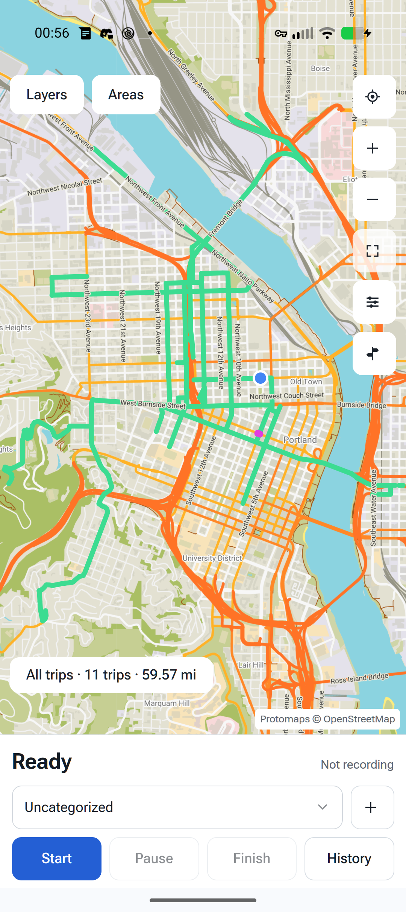
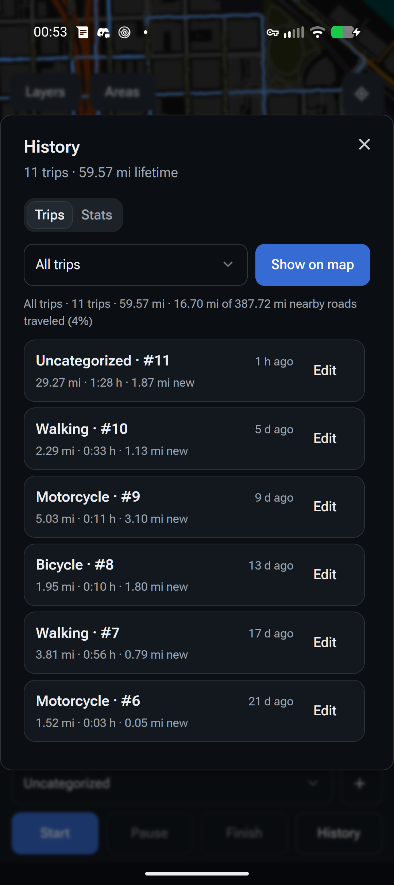
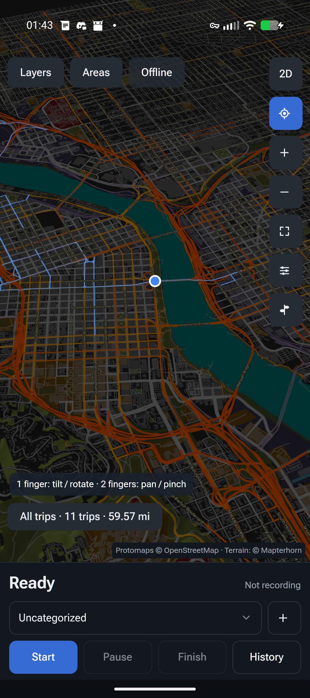

# Roamlog


Record trips. Track distance. Explore roads you have never traveled.

Roamlog is a local-first Android app built in Rust with
[Zgui](https://github.com/zortax/zgui). Create categories for walking, running,
bicycling, motorcycle rides, or anything else. Each trip keeps its path and
distance; shared road history shows where you have been across all trips.

<p>




</p>

Screenshots show synthetic Portland, Oregon demo trips, captured on Android.

- Record, pause, resume, and finish individual trips with GPS foreground service.
- Select multiple trips, filter by category/date, rename trips, and compare totals.
- Toggle GPS paths and traveled roads independently. Line widths and dashes
  distinguish overlays without relying only on color.
- Download offline vector maps; optionally use online satellite imagery.
- Switch to optional 3D terrain with vector map, road coverage, and GPS paths.
- Draw areas to measure road coverage and find nearby untraveled roads.
- Switch light/dark appearance independently of system theme.
- Check GitHub APK updates in app; download and install after finishing trip.
- Back up/restore local journal and export GPX. No account or trip upload service.

## Build and run

Linux desktop development:

```bash
cargo xtask run
```

Run `cargo xtask` for interactive build menu, or `cargo xtask help` for commands.
Run `cargo xtask verify` for formatting, core/UI tests, and Clippy; CI uses same task.

Android ARM64 build needs SDK 35, Build-Tools 35.0.0, NDK 28c, and JDK 17+:

```bash
rustup target add aarch64-linux-android
export ANDROID_HOME=/path/to/android-sdk
export ANDROID_NDK_HOME="$ANDROID_HOME/ndk/28.2.13676358"
cargo xtask android --release
adb install --no-incremental -r target/release/apk/roamlog.apk
```

Dependencies use pinned public Git revisions. Enlumi map foundations are vendored;
no sibling source checkouts are needed. See [build guide](docs/building.md),
[user guide](docs/user-guide.md), and [contributing](CONTRIBUTING.md).

## Storage and privacy

Trips live in private app storage as append-only `trips.jsonl`. Offline maps and
tile caches are local. Online maps reveal viewed regions to their providers;
**Offline** stops map requests and uses downloaded/cached data. Update checks
contact GitHub separately; disable automatic checks in Settings when desired.

Existing Android IDs remain `dev.traveler` and `dev.traveler.demo`; desktop data
stays under `~/.local/share/traveler`. Updates preserve history when installed
with same signing key. Uninstalling removes local app data. Back up before
changing installations; see [signing and updates](docs/building.md#signing-and-updates).

## Status

Early development. GPS matching estimates traveled sections; it cannot prove
which route was taken. Inferred segments remain labeled. Long outdoor recordings,
process-death behavior, and distance accuracy need more field validation.
See [matching and performance](docs/gps-recovery-and-performance.md) and
[Zgui integration](docs/zgui-mobile-extraction.md).

## License

[Apache-2.0](LICENSE), matching Zgui. Third-party code and map data retain their
own notices and licenses; see [NOTICE](NOTICE) and [Enlumi provenance](vendor/enlumi/README.md).
