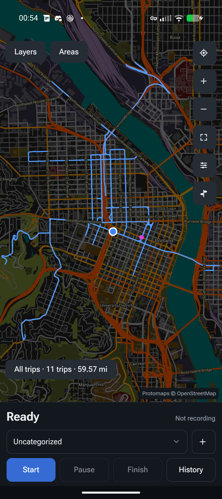

# Roamlog


Record trips. Track distance. Explore roads you have never traveled.

Roamlog is a local-first Android app built in Rust with
[Zgui](https://github.com/zortax/zgui). Create categories for walking, running,
bicycling, motorcycle rides, or anything else. Each trip keeps its path and
distance; shared road history shows where you have been across all trips.
Optionally share your location and finished trips with friends and groups through
encrypted phone-to-phone connections, without a Roamlog account.

<p>



</p>

Screenshots show synthetic Portland, Oregon demo trips, captured on Android.

- Record, pause, resume, and finish individual trips with GPS foreground service.
- Select multiple trips, filter by category/date, rename trips, and compare totals.
- Toggle GPS paths and traveled roads independently. Line widths and dashes
  distinguish overlays without relying only on color.
- Download offline vector maps; optionally use online satellite imagery.
- Switch to optional 3D terrain with vector map, road coverage, and GPS paths.
- Draw areas to measure road coverage and find nearby untraveled roads.
- Switch light/dark appearance independently of system theme.
- Share live locations with friends and groups, and view friends' finished trips
  alongside your own history.
- Check GitHub APK updates in app; download and install after finishing trip.
- Back up/restore local journal and export GPX.

## Location sharing

On Android, open **Friends** on the map to pair by QR code or invitation link,
then compare the confirmation codes on both phones. New direct friends start with
location access **Hidden**. Choose **Hidden**, **Trips**, or **Always** for each
friend or group, and set your overall sharing mode to **Off**, **During trips**,
or **Always**. **Off** closes all sharing connections; **During trips** sends your
location only while recording, while still receiving friends' positions.

Groups let trusted people share with one another without pairing every phone
individually. A friend's access is the higher of their individual and group
permissions, subject to your overall mode. New groups start with **Always**
access, and any member can invite others, so join only groups you trust.

Friends appear on the map with their latest location. Finished trips sync with
friends who currently have access to your location while sharing is enabled;
received trips stay separate from your own unless you explicitly copy one.
See the [location-sharing guide](docs/location-sharing.md) for setup, controls,
and limitations.

### How it works

- **Encrypted peer connections:** [Iroh](https://www.iroh.computer/) provides
  authenticated QUIC connections, using public discovery and relay infrastructure
  to connect phones across networks. Connections can be direct or relayed;
  relays forward encrypted packets and cannot read their contents. No Roamlog
  server stores your shared locations or trips.
- **Device identity:** an Ed25519 identity key is wrapped using Android Keystore.
  Pairing establishes trusted peers; the sending phone checks sharing permissions
  before every packet.
- **Rust networking:** Tokio runs the asynchronous sharing tasks. Compact
  `postcard`-encoded location updates use QUIC datagrams with sequence numbers and
  replay checks; group membership and trip requests use reliable QUIC streams.
- **Android background service:** sharing runs in the recorder service process
  with a foreground notification and **Pause sharing** action. It reuses trip GPS
  while recording; **Always** mode uses an adaptive location watch otherwise,
  sampling less often when stationary.

### Limitations

- **Android only, with no guaranteed availability.** Both phones need a working
  network connection to exchange updates. Public discovery and relays are external
  dependencies; restrictive networks or service outages can prevent connections.
  There is no Roamlog server to hold updates for an offline friend.
- **Background operation can stop.** Force-stop, power-off, battery restrictions,
  or Android refusing a background location service start can interrupt sharing.
  After reboot, you may need to open Roamlog to resume. Pairing also temporarily
  pauses the service's sharing endpoint.
- **Locations are periodic estimates.** Moving updates use a selected 15/30/60 s
  interval; stationary phones sample every 5 minutes and send at most every
  10 minutes. These are scheduling targets, not delivery guarantees. A marker can
  show an older position, and encryption authenticates the phone, not its GPS fix.
- **Access and copies need care.** Group access can override a friend's individual
  Hidden setting, and any group member can invite others. Removing or blocking
  someone stops future updates but cannot erase locations or trips already received.
- **Sync and recovery are limited.** Finished trips sync on connection and every
  6 hours, rather than continuously. Resetting your identity or reinstalling
  requires pairing again; there is no cloud identity recovery.

See [location-sharing limits](docs/location-sharing.md#limits) for retention,
transfer limits, and background recovery details.

## Build and run

Linux desktop development:

```bash
cargo xtask run
```

Run `cargo xtask` for interactive build menu, or `cargo xtask help` for commands.
Run `cargo xtask verify` for formatting, core/UI tests, and Clippy; CI uses same task.

Android ARM64 build needs SDK 35, Build-Tools 35.0.0, NDK 28c, and JDK 17+:

```bash
rustup target add aarch64-linux-android
export ANDROID_HOME=/path/to/android-sdk
export ANDROID_NDK_HOME="$ANDROID_HOME/ndk/28.2.13676358"
cargo xtask android --release
adb install --no-incremental -r target/release/apk/roamlog.apk
```

Dependencies use pinned public Git revisions. Enlumi map foundations are vendored;
no sibling source checkouts are needed. See [build guide](docs/building.md),
[user guide](docs/user-guide.md), and [contributing](CONTRIBUTING.md).

## Storage and privacy

Trips live in private app storage as append-only `trips.jsonl`. Offline maps and
tile caches are local. Online maps reveal viewed regions to their providers;
**Offline** stops map requests and uses downloaded/cached data. Update checks
contact GitHub separately; disable automatic checks in Settings when desired.
Location sharing uses a separate network connection; turn sharing **Off** in
**Friends** to stop it. Received locations retain only the latest position per
friend for up to 24 hours. Shared finished trips are stored separately on the
receiving phone. Resetting your sharing identity or reinstalling requires pairing
again; there is no cloud backup of your sharing identity.

Existing Android IDs remain `dev.traveler` and `dev.traveler.demo`; desktop data
stays under `~/.local/share/traveler`. Updates preserve history when installed
with same signing key. Uninstalling removes local app data. Back up before
changing installations; see [signing and updates](docs/building.md#signing-and-updates).

## Status

Early development. GPS matching estimates traveled sections; it cannot prove
which route was taken. Inferred segments remain labeled. Long outdoor recordings,
process-death behavior, and distance accuracy need more field validation.
See [matching and performance](docs/gps-recovery-and-performance.md) and
[Zgui integration](docs/zgui-mobile-extraction.md).

## License

[Apache-2.0](LICENSE), matching Zgui. Third-party code and map data retain their
own notices and licenses; see [NOTICE](NOTICE) and [Enlumi provenance](vendor/enlumi/README.md).
